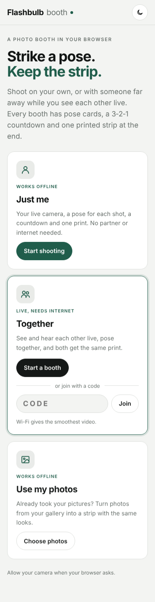
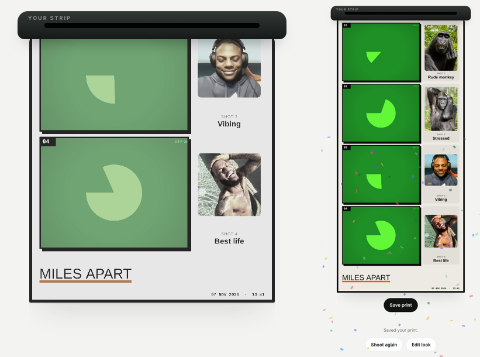
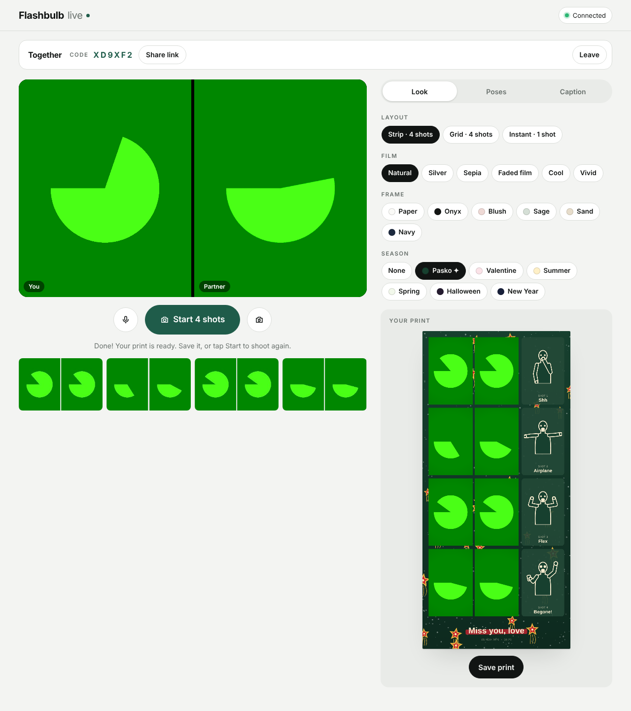
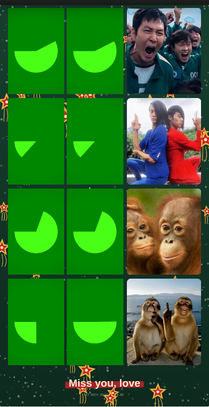
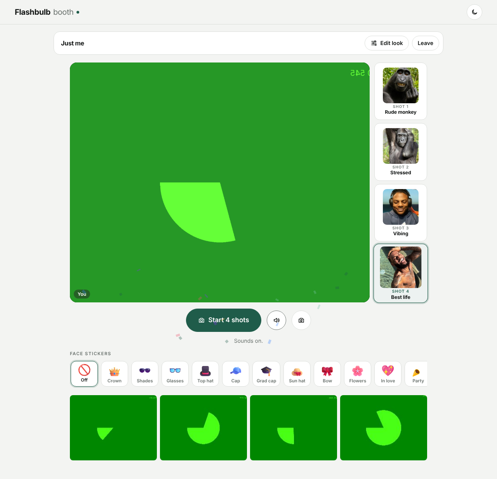
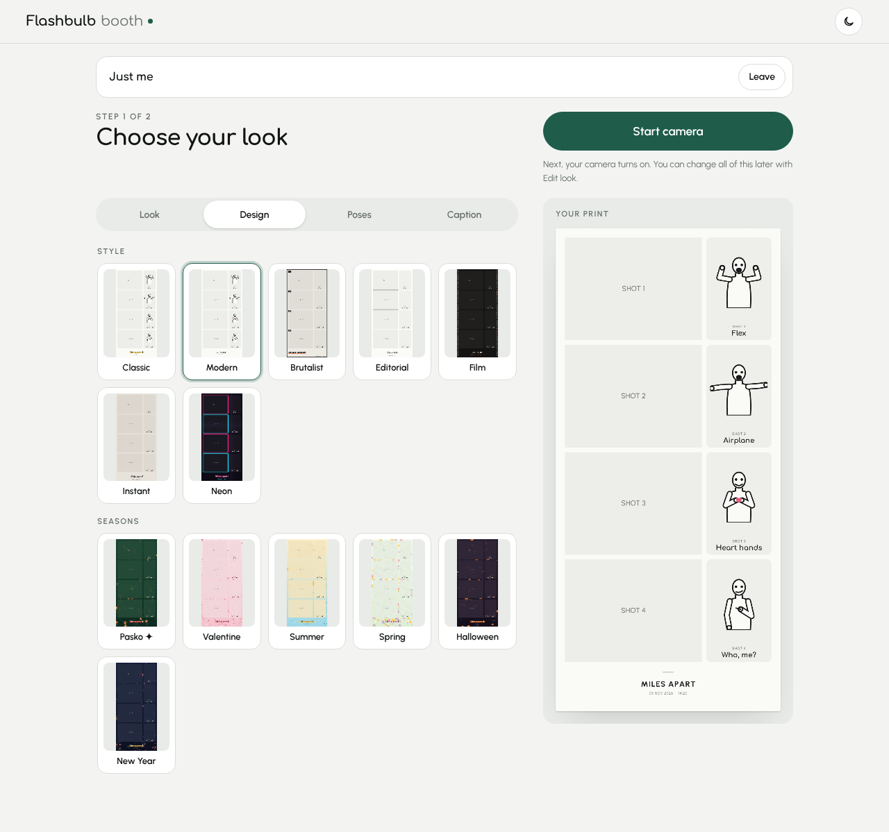
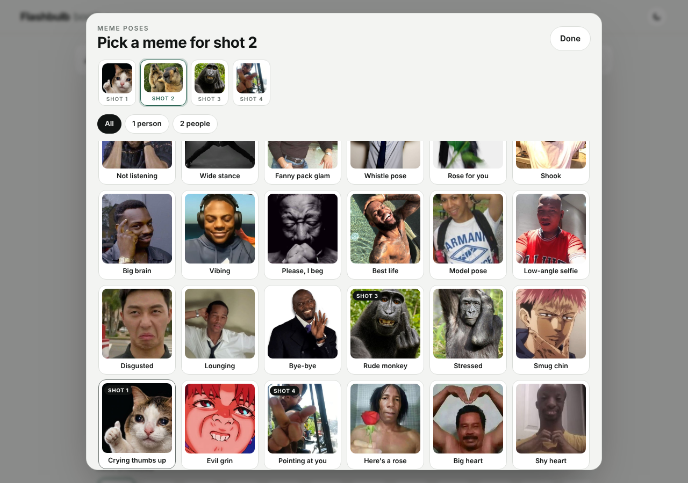
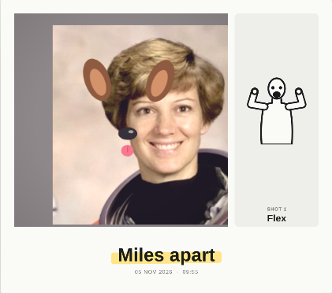

# Flashbulb Photo Booth

[](https://github.com/pork-arie/Online-Photo-booth-/actions/workflows/test.yml)

A photo booth in your browser. Shoot on your own, or with someone far away while you see and hear each other live. Every booth has pose cards, a 3‑2‑1 countdown, and a printed strip that drops out of the slot at the end.



## Three ways to shoot

| | What it does | Internet |
|---|---|---|
| **Just me** | Your live camera, a pose for each shot, a countdown and one print | Not needed after the first visit |
| **Together** | Two people far apart see and hear each other live, pose together and both get the same print | Needed |
| **Use my photos** | Turn photos from your gallery into a strip with the same looks. Face stickers go on the faces in your photos too | Not needed after the first visit |

### How a booth works

1. **Choose your look.** Before any camera turns on, pick your layout, film, design, poses and caption, with a big preview of your print beside them.
2. **Shoot.** Tap **Start camera** (or **Open my booth** in Together). Now the screen shows only your camera, the poses beside it and the shutter button. To change something, tap **Edit look** and the settings slide in from the side.
3. **Your print drops out.** After the last flash, the strip feeds out of the booth slot with a motor sound, settles and develops. Then save it, **Shoot again** or **Edit look**.



### Together, step by step

1. **Start a booth.** Choose your look, tap **Open my booth** and allow your camera and microphone. You get a 6‑letter code and a **Share link** button.
2. **Your partner joins** from the link, or by typing the code and tapping **Join**.
3. **See each other live.** You're on the left and your partner is on the right. Use the mic button to mute, and the camera button to switch between front and back cameras.
4. **Tap Start 4 shots.** Both screens show the same pose card, count down together and flash. Each phone takes a full-quality photo from its own camera, and the two phones swap photos automatically.
5. **Save the print**. **Share print** sends it straight to apps on your phone.

If the connection drops for a moment, the booth reconnects by itself.





### Just me



## Works offline and installs like an app

After you've opened the booth once, **Just me** and **Use my photos** keep working with no internet. On your phone, use **Add to Home Screen** (Safari) or **Install app** (Chrome) to keep Flashbulb on your home screen. **Together** still needs internet, because it connects two phones.

## Print designs

The **Design** tab shows a small live preview of your print in every style, so you can see it before you pick:

| Design | Look |
|---|---|
| **Classic** | Your frame color with rounded type and a marker highlight |
| **Modern** | Clean white card, soft shadows, rounded photos, small spaced type |
| **Brutalist** | Heavy black borders, hard shadows, numbered frames, big black type with an orange bar |
| **Editorial** | Thin rules and an italic serif caption, like a magazine |
| **Film** | Black film stock with sprocket holes and orange edge numbers |
| **Instant** | Little tilted instant photos on a table, with a handwritten caption |
| **Neon** | Dark grid with glowing pink and cyan frames |

The **season** themes (Pasko, Valentine, Summer, Spring, Halloween, New Year) are in the same tab. In Together the design is synced to both screens.



## Meme poses

Pick **Meme** in the Poses tab and every shot gets a meme to copy, shown beside the camera and printed beside your photo. Tap the grid button beside the shutter to browse them all and choose your own.



## Face stickers

Pick a sticker under the camera and it follows your face as you move, like the filters in photo booth apps. It works with more than one face in the frame.

- **3D accessories** ([Fluent Emoji](https://github.com/microsoft/fluentui-emoji) by Microsoft, MIT): 👑 Crown · 🕶️ Shades · 👓 Glasses · 🎩 Top hat · 🧢 Cap · 🎓 Grad cap · 👒 Sun hat · 🎀 Bow · 🌸 Flower crown
- **Animated effects** ([Noto Animated Emoji](https://googlefonts.github.io/noto-emoji-animation/) by Google, CC BY 4.0): 💖 In love · 🎉 Party · 💫 Dizzy · ✨ Sparkle · 🔥 On fire · 🦋 Butterflies
- **Drawn:** 🐶 Puppy · 🐱 Kitty · 🎅 Santa hat

Stickers show in your preview, in every photo on the print and, in Together, on your partner's screen (you each pick your own). Face tracking runs on your phone with [face-api](https://github.com/vladmandic/face-api) (MIT). No video is uploaded, and it all works offline. Full credits are in [`assets/stickers/CREDITS.md`](assets/stickers/CREDITS.md).



## Save the print

When your shots are done, the print drops out of the slot and develops like an instant photo, with a burst of confetti. Tap **Save print** for the full strip as a PNG picture.

On iPhone and iPad (Safari), **Save print** opens the share sheet: tap **Save Image** to put it in Photos. If the share sheet can't open (older iOS, or in-app browsers like Instagram and Messenger), the print opens full screen instead: press and hold it, then tap **Save to Photos**.

## Features

- **Layouts:** Strip (4 shots), Grid (2 × 2) or Instant (1 big shot). In Together, you and your partner are side by side in every frame.
- **Film looks:** Natural, Silver, Sepia, Faded film, Cool, Vivid
- **Designs:** Classic, Modern, Brutalist, Editorial, Film, Instant and Neon (see above)
- **Frame colors:** Paper, Onyx, Blush, Sage, Sand, Navy, used by the Classic and Modern designs
- **Season themes:** Pasko (parol lanterns and snow), Valentine, Summer, Spring, Halloween, New Year. The theme for the current month is marked ✦.
- **Start page:** an illustrated photo booth with blinking bulbs, a swaying curtain, a flash and a strip coming out of the slot
- **Pose guide:** Off, Classic (emoji poses) or Meme: 35 one-person and 23 two-person meme pictures to copy, such as Time out, Big brain, Shook, Crying thumbs up, Finger guns, Force push and Hold me back. Poses can be printed beside each photo.
- **Browse memes:** tap the grid button beside the shutter (or **Browse memes** in the Poses tab) to see every meme. Pick the shot at the top, then tap a meme to use it, and it moves on to the next shot. Filter by 1 person or 2 people. In Together, your partner sees your picks.
- **Caption** with a marker-style highlight that matches the frame colors
- **Solo and Duo poses:** Solo memes have one person. Duo memes have two people (Leg heart, Finger guns, Lean back, Wheelbarrow, Anime clash and more), so in Together each person copies their side, labeled You and Partner beside the camera. Solo also includes the two-person memes, so in Just me you can copy one side or grab a friend. Together starts with Duo and Just me with Solo, and you can switch in the Poses tab.
- **Poses beside the camera:** the poses for your shots sit in a column next to the camera (on phones, in a swipeable row right under it, so the camera keeps the full width). Tap one to pick it. During the countdown, the current shot's pose stays there and pulses, so you can copy it while you pose.
- **White or dark:** the booth is white by default. Use the moon button at the top to switch to dark, and it remembers your choice.
- **Settings in four tabs:** Look (layout, film, frame color), Design (styles and seasons), Poses (guide, the upcoming poses, picking one and swapping with ↻) and Caption. Before shooting they fill the screen; while shooting they're behind **Edit look**.
- **Synced settings in Together:** whatever either person changes appears on both screens
- **Sounds:** beeps on 3, 2, 1 and a shutter click on the flash. The speaker button turns them off.
- **Motion:** the print feeds out of the slot and develops, confetti when it's ready, shots pop in, and stickers wiggle when picked. All of this switches off if your phone is set to reduce motion.
- **Lighter mode:** on slower phones the booth switches to lighter face tracking and a smaller camera picture by itself, so it stays smooth.

## Put it online (GitHub Pages)

Phones only allow the camera on secure (https) pages, and GitHub Pages provides that for free.

1. In this repo, go to **Settings → Pages**.
2. Under **Build and deployment**, set **Source** to *Deploy from a branch*, choose **main** and **/ (root)**, then **Save**.
3. After a minute your booth is live at `https://pork-arie.github.io/Online-Photo-booth-/`.

Any other static host works too, for example Netlify or Cloudflare Pages. There's no build step: upload the folder as it is.

## Make Together work on mobile data (relay server)

The two phones normally connect directly. Many mobile data networks block that, so Together fails with "Couldn't connect your videos directly". A **relay (TURN) server** fixes it. Metered.ca has a free plan:

1. Make a free account at [metered.ca](https://www.metered.ca/stun-turn) and create a TURN app.
2. In its dashboard, find the **TURN Server Credentials API** URL. It looks like `https://YOUR-APP.metered.live/api/v1/turn/credentials?apiKey=…`.
3. Open [`config.js`](config.js) in this repo, paste the URL into `turnCredentialsUrl`, and commit.

The booth then uses the relay only when a direct connection isn't possible. `config.js` is public on your site, so keep an eye on usage in Metered's dashboard.

## Good to know

- **Connection:** the two phones find each other through the free public [PeerJS](https://peerjs.com) server. After that, video and photos go directly between the two phones (or through your relay) and are not stored on any server. If the PeerJS service is busy, the booth tries again by itself.
- **Your own connection server (optional):** for more reliability, run the PeerJS server yourself (for example `npx peerjs --port 9000`, or the free [PeerJS server template](https://github.com/peers/peerjs-server) on Render), then fill in `peerServer` in `config.js`.
- **Limit:** two people per booth. A third person who tries to join is told the booth is full.

## Project layout

| Path | What it is |
|---|---|
| `index.html` | The page: start screen and booth layout |
| `css/booth.css` | All the styles, light and dark |
| `js/booth.js` | The app: camera, connection, shooting and the print |
| `js/looks.js` | Layouts, film looks, frame colors and season themes |
| `js/designs.js` | Print designs: Classic, Modern, Brutalist, Editorial, Film, Instant, Neon |
| `js/poses.js` | Pose list: classic emoji poses and meme pictures, solo and duo |
| `assets/memes/` | The meme pose pictures (`solo/` and `duo/`) |
| `js/stickers.js` | Face sticker artwork and placement |
| `config.js` | Your settings: relay server and own connection server |
| `solo/index.html` | Old link for the strip maker; it opens Use my photos |
| `sw.js` | Keeps the booth working offline after the first visit |
| `assets/stickers/` | Sticker artwork: Fluent Emoji 3D accessories and Noto animated emoji (see `CREDITS.md`) |
| `vendor/face-api/` | Face tracking for the stickers ([face-api](https://github.com/vladmandic/face-api), MIT license) and its two small models |
| `.github/workflows/test.yml` | Runs the automated test on GitHub after every push |
| `manifest.webmanifest`, `icons/` | Lets phones install the booth like an app |
| `tests/` | End-to-end test for the whole booth |
| `docs/` | Screenshots used in this README |

## Test it

### On your phones (after GitHub Pages is on)

1. On phone 1, open `https://pork-arie.github.io/Online-Photo-booth-/`, tap **Start a booth**, pick a design, tap **Open my booth** and allow the camera and microphone.
2. Tap **Share link** and send it to phone 2. On phone 2, open the link and tap **Join**.
3. Check that each phone shows both cameras, with you on the left on the host phone, and that you can hear each other.
4. Tap **Edit look** and change the film or design on one phone. It should change on the other.
5. Tap **Start 4 shots**. Both phones should show the same pose and countdown, and after 4 flashes the same print should drop out on both.
6. Tap **Save print** and check the picture is in your downloads or photos.
7. Go back, tap **Just me** and take a strip on your own.
8. Turn on airplane mode and open the link again: **Just me** should still work.

If the cameras don't connect, try both phones on Wi-Fi first (see "Mobile data" above).

### On one computer

Open the booth link in a normal window and in a private (incognito) window, then start in one and join from the other. Both windows use the same camera, so you'll see yourself twice, but it shows that everything works.

### Automated test

The test runs on GitHub after every push (see the **Actions** tab and the badge at the top). To run it on your computer:

```bash
cd tests
npm install
npx playwright install chromium
npm test
```

The test starts a local web server and a local PeerJS server, opens two browsers with fake cameras, then checks the following:

- live video and audio in both directions
- that the invite link fills in the code
- that Choose your look comes first with the camera off, and the design picked there reaches your partner
- that settings sync both ways through the Edit look drawer
- that both prints drop out of the slot
- that both screens get the same pose and countdown
- that all 8 photos arrive (4 from each person)
- that saving downloads the print
- that a dropped connection reconnects by itself and the video comes back
- what happens when a partner leaves
- that the phone layout doesn't scroll sideways
- Just me: the Design tab (7 styles and 6 seasons with previews, picking one restyles the print), the camera, pose list and swapping, 4 shots, sounds, the print dropping out and developing, Shoot again, and saving the print (with no Save video button)
- offline: the booth, Just me and Use my photos open with no internet
- face stickers, using a fake camera made from a public-domain portrait (`tests/fixtures/`): the face is found, stickers appear, follow the face and stay steady, end up in the print, and your partner sees them
- lighter mode still tracks faces
- iPhone saving: Save print opens the share sheet with the picture right on the tap, and falls back to press and hold
- Browse memes: every meme shows, the 1 person and 2 people filters, tapping a meme sets that shot and moves to the next, it syncs to your partner, and Escape and Done close it
- Use my photos: adding photos, picking a slot, stickers placed on a face in a photo, the print dropping out once every slot is filled, saving, and the old `/solo/` link

It ends with `PASS` or `FAIL` for each check. Screenshots are saved to `tests/test-output/`.
