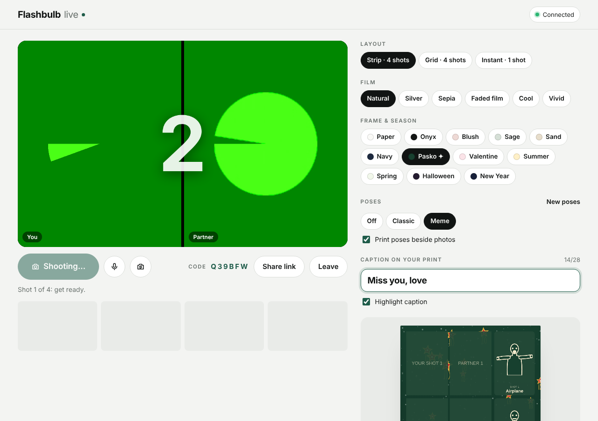

# Flashbulb Live

A live photo booth for two people who are far apart. You see and hear each other, get the same pose and the same 3‑2‑1 countdown, and end up with one shared photo strip.



## How it works

1. **Start a booth.** Allow your camera and microphone. You get a 6‑letter code and a **Share link** button.
2. **Your partner joins** from the link, or by typing the code and tapping **Join**.
3. **See each other live.** You're on the left, your partner is on the right, and you can talk. There are buttons to mute and to switch between front and back cameras.
4. **Tap Start 4 shots.** Both screens show the same pose card (for example "Shot 2 of 4: Heart hands"), count down together and flash. Each phone takes a full-quality photo from its own camera, and the two phones swap photos automatically.
5. **Save the print** as a PNG, or **Share print** straight to apps on your phone.


## Features

- **Layouts:** Strip (4 shots), Grid (2 × 2) or Instant (1 big shot), with you and your partner side by side in every frame
- **Film looks:** Natural, Silver, Sepia, Faded film, Cool, Vivid
- **Frames:** Paper, Onyx, Blush, Sage, Sand, Navy
- **Season themes:** Pasko (parol lanterns and snow), Valentine, Summer, Spring, Halloween, New Year. The theme for the current month is marked ✦.
- **Pose guide:** Off, Classic (emoji poses) or Meme (line-drawn meme poses such as Time out, Begone!, Airplane and Who, me?). Poses can be printed beside each photo.
- **Caption** with a marker-style highlight that matches the frame colors
- **Synced settings:** whatever either person changes appears on both screens

## Put it online (GitHub Pages)

Phones only allow the camera on secure (https) pages, and GitHub Pages provides that for free.

1. In this repo, go to **Settings → Pages**.
2. Under **Build and deployment**, set **Source** to *Deploy from a branch*, choose **main** and **/ (root)**, then **Save**.
3. After a minute your booth is live at `https://pork-arie.github.io/Online-Photo-booth-/`.

Any other static host works too, for example Netlify or Cloudflare Pages. The whole app is one file: `index.html`.

## Good to know

- **Connection:** the two phones find each other through the free public [PeerJS](https://peerjs.com) server. After that, video and photos go directly between the two phones and are not stored on any server.
- **Mobile data:** some mobile networks block direct connections between phones. If you see "Couldn't connect your videos directly", try both on Wi-Fi. For networks that need it, a relay (TURN) server can be added through the link:
  `?turn=turn:your.server:3478&turnuser=USER&turnpass=PASS`
- **Your own connection server:** you can run your own PeerJS server and point the booth at it with `?peerhost=example.com&peerport=443&peerpath=/`.
- **Limit:** two people per booth. A third person who tries to join is told the booth is full.

## Project layout

| Path | What it is |
|---|---|
| `index.html` | The live booth (HTML, CSS and JavaScript in one file) |
| `tests/` | End-to-end test: two browsers with fake cameras shoot a strip together |
| `claude-booth/flashbulb-booth.html` | The original single-player booth built as a Claude artifact (home page, Together mode through Claude's shared storage). It runs inside Claude, not as a standalone page. |
| `docs/` | Screenshots used in this README |

## Run the tests

```bash
cd tests
npm install
npx playwright install chromium
npm test
```

The test starts a local web server and a local PeerJS server, opens two browsers with fake cameras, then checks the following:

- live video and audio in both directions
- that the invite link fills in the code
- that settings sync both ways
- that both screens get the same pose and countdown
- that all 8 photos arrive (4 from each person)
- that saving downloads the print
- what happens when a partner leaves
- that the phone layout doesn't scroll sideways

Screenshots are saved to `tests/test-output/`.
